# Hamilton dataset groupings by spine role (read-only, 2026-10-17 ET)

**Scope.** Every relevant Hamilton dataset, grouped by its role in joining, matching and spine development. The row-level detail is in `hamilton-dataset-groupings.csv` (396 rows).
- **Inputs:** `hamilton-dataset-coverage.csv` (606 rows, 2026-10-16), `mpac-data-inventory.md`, the NPCA pull `PULL-SUMMARY.json` on deb, and heavymap `main` df55512 (`parcel-identity-spine.md`, `context-band-ladder.md`, `PCDP.md`, planning doc 10, joining concepts).
- **Live metadata:** ArcGIS REST `?f=json` and `returnCountOnly` were queried on 2026-10-17 for 200+ layers on the City, HCA, Conservation Halton source protection, NPCA, LIO and GRCA-proxy servers. Fields and counts in the CSV marked `live REST` are measured. The CSV `evidence` column says `live_rest`, `local_pull`, `catalog_only` or `inferred`.
- **Nothing was downloaded, committed or published.** The vocabulary follows the Context Band Ladder (`identity`, `land_use`, `constraints`, `activity_registers`, `derived_readings`, `share_export`) and the PCDP minimum and maximum.

## Counts
- **606 coverage rows:** 237 `reviewed_not_relevant` are excluded and 369 are grouped. The 2026-10-17 web check added 27 more, so the CSV has 396 rows.
- **Duplicates:** 19 rows are duplicates, mostly MCS "Hamilton …" rows that point at the same layer. That leaves 377 distinct datasets.
- **Not data layers:** 62 rows are viewers, PDFs or pages, and 11 are other geographies (New York, Welland, Seaway, Brant, CBSA).
- **Usable layers:** 304 data-bearing Hamilton datasets.
- **Proposed re-admits:** 3 datasets are marked `reviewed_not_relevant` but are needed for the nature-framed first view: Parks_OD, Trails and HCA Trails (A04, A05, A27). They are listed as proposals, not re-admitted.

## Tier summary
| Tier | Meaning | Rows | P1 | P2 | P3 | Dup |
|---|---|---|---|---|---|---|
| Tier 0 | True base / identity (defines spine keys) | 9 | 5 | 2 | 0 | 2 |
| Tier 1 | Key-joinable attributes (ID join) | 4 | 0 | 0 | 4 | 0 |
| Tier 2 | Spatial-match layers (overlay / point-in-polygon) | 81 | 11 | 25 | 34 | 11 |
| Tier 3 | Pure context overlays (display, not joined) | 76 | 9 | 8 | 57 | 2 |
| Tier 4 | Registers without geometry (address/geocode) | 19 | 0 | 5 | 11 | 3 |
| Tier 5 | Aggregate / derived stats (not parcel-level) | 134 | 0 | 0 | 133 | 1 |
| Viewer/document only | Web app, story map, PDF or page — no layer | 62 | 0 | 0 | 0 | 0 |
| Out of geography | Not Hamilton (NY, Welland, Seaway, Brant, CBSA) | 11 | 0 | 0 | 0 | 0 |
| **All** | | **396** | **25** | **40** | **239** | **19** |

How to read the tiers:
- **Tier 0 is thin on purpose.** Hamilton parcel geometry has no key, so the spine key is minted from the geometry. NPCA ARN parcels, address points and buildings attach to it, and the City Boundary is the clip mask.
- **Tier 1 is almost empty.** Hamilton publishes no shared parcel ID. The only ID joins are by ARN, which exists on 36% of the city through the NPCA pull (MPAC itself, plus 23 HCA managed-forest rows), and by address string between two address sets.
- **Most of the work is in Tier 2 and Tier 4.** Spatial overlays attach almost all parcel context. The registers attach by address, through the address points linked to the spine.
- **Tier 5 is mostly noise.** 59 of its 133 rows are StatCan Business Counts releases at CMA/CSD level. The rest are City dashboard tables by year or ward, and census polygons.

## Recommended processing order (P1, dependency sequence)
Steps 1 to 16 are the spine track and run in order. Steps 17 to 25 are the nature and context track. That track depends only on the City Boundary, so it can run in parallel from the start, for example as a separate Codex batch.

| # | Row | Dataset | Tier | Count (live) | Join key | Join method | Difficulty | Needs first | Feeds |
|---|---|---|---|---|---|---|---|---|---|
| 1 | C205 | City Boundary | 0 | 1 | n/a (single polygon) | clip / containment | easy | — | identity |
| 2 | C358 | Hamilton Assessment Parcel (166,828 polygons, geometry only) | 0 | 166828 | none published; mint hm:ca:on:hamilton:parcel:{geom-hash} (quantised … | n/a — mints the spine key | medium | City Boundary (clip/QA) | identity |
| 3 | A01 | NPCA Assessment Parcels with ARN (Hamilton clip, pulled 202… | 0 | 90306 | ARN (15-digit); ASSESSMENT (20) → 19-digit roll form | reciprocal representative-point match to Hamilton Assessment Parcel (99.6% 1:1 … | medium | Hamilton Assessment Parcel | identity|land_use |
| 4 | C004 | Addresses | 0 | 274725 | normalised civic address (NUMBER_COMPLETE + UNIT + FULL_STREET_NAME +… | point-in-polygon to parcel; 1 parcel : many addresses | medium | Hamilton Assessment Parcel | identity |
| 5 | C003 | Buildings | 0 | 214292 | none (NAME only); mint footprint geometry hash | polygon overlay — assign footprint to parcel of largest overlap | medium | Hamilton Assessment Parcel | identity|derived_readings |
| 6 | C206 | Community Boundaries | 2 | 6 | COMMUNITY_NAME | parcel centroid-in-polygon | easy | Hamilton Assessment Parcel | identity |
| 7 | C002 | Zoning By-law Boundary | 2 | 11860 | ZONING_CODE, BY_LAW_NUMBER, EXCEPTION1-3, HOLDING1-3 | polygon overlay; area-weighted dominant zone + list of all zones touching parcel | medium | Hamilton Assessment Parcel | land_use|constraints |
| 8 | A02 | Existing Land Use Primary Blocks (LandUsePrimaryBlockHam_sh… | 2 | 22391 | PRIMARY_LA | polygon overlay; area-weighted dominant class per parcel | medium | Hamilton Assessment Parcel | land_use |
| 9 | C001 | Employment Lands | 2 | 22 | AREA_NAME, CATEGORY | parcel centroid-in-polygon (large districts) | easy | Hamilton Assessment Parcel | land_use |
| 10 | C164 | Urban Boundary | 2 | 1 | n/a | parcel centroid-in-polygon flag | easy | Hamilton Assessment Parcel | land_use |
| 11 | C180 | Rural Settlement Areas | 2 | 19 | NAME | parcel centroid-in-polygon | easy | Hamilton Assessment Parcel | land_use |
| 12 | A07 | Conservation authority watershed areas in Hamilton (HCA / C… | 2 | 4 (1 each) | CONSERVATION_AUTHORITY | parcel centroid-in-polygon | easy | Hamilton Assessment Parcel | constraints |
| 13 | C255 | HCA: HCA Regulated Areas | 2 | 137 | n/a (Version only) | polygon intersect; % of parcel area regulated | medium | Hamilton Assessment Parcel | constraints |
| 14 | A09 | NPCA Approximate Regulation Lands | 2 | 443 in Hamilton bbox | — | polygon intersect; % area | medium | Hamilton Assessment Parcel | constraints |
| 15 | C114 | Heritage Properties | 2 | 10273 | STREET_NO_1 + STREET_NAME (address); BYLAW_NO | point-in-polygon; address match as cross-check | easy | Hamilton Assessment Parcel; Addresses (cross… | constraints |
| 16 | C160 | Development Applications | 2 | 5237 | FILE_NUM, ADDRESS | point-in-polygon; address match as fallback | easy | Hamilton Assessment Parcel; Addresses | activity_registers |
| 17 | A12 | Greenbelt Outer Boundary | 3 | 1 in Hamilton bbox |  | display | easy | City Boundary |  |
| 18 | C363 | Greenbelt Designation (LIO Open06/15) | 3 | 20 in Hamilton bbox (90 Ontario-wide) | DESIGNATION | display (can become a Tier 2 constraint overlay later) | easy | City Boundary | land_use|constraints |
| 19 | A17 | Niagara Escarpment Plan Area boundary | 3 | 1 in Hamilton bbox |  | display | easy | City Boundary |  |
| 20 | C364 | Niagara Escarpment Plan Boundary + Designation (LIO Open06/… | 3 | 197 in Hamilton bbox (1,211 Ontario-wid… | DESIGNATION | display (can become Tier 2 overlay later) | easy | City Boundary | land_use|constraints |
| 21 | A04 | Parks (Parks_OD) | 3 | 633 | NAME, PARK_CLASS, ZONING_COD | display (nature frame) | easy | City Boundary |  |
| 22 | A22 | Wooded Areas (provincial) | 3 | 7483 in Hamilton bbox | CLASS_SUBTYPE;CLASS_SUBTYPE_NUM;WOODED_AREA_TYPE;TYPE_OTHER_DESCR | display (nature frame) | easy | City Boundary |  |
| 23 | C145 | Escarpment | 3 | 1 | — | display | easy | City Boundary |  |
| 24 | C005 | Railways | 3 | 1692 | RAILWAY_CATEGORY | display; optional distance-to-rail reading | easy | City Boundary | derived_readings |
| 25 | C006 | Truck Route Network | 3 | 1250 | STREET_NAME, IS_TRUCK_ROUTE, RESTRICTED | display; optional frontage-on-truck-route reading | easy | City Boundary | derived_readings |

### Stage view
1. **Stage A, fetch (parallel).**
   - Pull every P1 layer clipped to the City Boundary.
   - Most are under 2k features. The big ones are parcels (166,828), addresses (274,725), buildings (214,292), existing land use (22,391) and zoning (11,860).
   - Parcels and NPCA ARN are already local on deb.
2. **Stage B, spine (Tier 0).**
   - Mint `hm:ca:on:hamilton:parcel:{hash}` from each parcel geometry.
   - Attach the NPCA ARN by reciprocal representative point. Attach addresses by point-in-polygon, and buildings by largest overlap.
   - Output one parcels table carrying: key, grain, community, ARN where present, address list and building count.
   - This is the only stage that needs Claude Code-grade care.
3. **Stage C, land_use (Tier 2).**
   - Zoning: dominant code plus all touching codes, with exceptions and holdings kept as `zoning_site_modifier`.
   - Existing land use: dominant class.
   - Employment Lands, Urban Boundary and Rural Settlements: centroid flags.
4. **Stage D, constraints (Tier 2).**
   - Name the regulating conservation authority from the CA areas layer (A07).
   - Take the % of each parcel inside the HCA and NPCA regulated areas.
   - Attach heritage by point-in-polygon.
   - Parcels in Conservation Halton or GRCA territory get `not_joined` / `not_in_coverage` refusals rather than silence.
5. **Stage E, activity_registers.** Attach development applications by point-in-polygon. (P2 adds permits 2017+, licences and NPRI by address match. See below.)
6. **Stage F, nature and context.** Display-only PMTiles layers: Greenbelt outer boundary and designation, NEP boundary and designation, Parks, Wooded Area, Escarpment, Railways, Truck Routes.

### Next after P1 (P2, in dependency order)
- **Identity helpers:** Street Centreline, the geocoder fallback for Tier 4 (C163), and the LIO municipal boundary, whose `ASSESSMENT_CODE` checks the ARN prefix 2518 (A25).
- **More constraints:**
  - Wetlands (A06), ESA (C134) and ANSI (A21).
  - The 10 HCA/CH source-water protection layers (WHPA, IPZ, HVA, SGRA).
  - GRCA regulation limits through the Region of Waterloo proxy, 188 Hamilton polygons (A10).
  - Conservation Halton, which has no open endpoint (A11).
- **Land-use extras:** PSEZ (C365), OSM industrial land (C244), City Properties (C224), land disposition parcels (C359), and the Official Plan designations (C362), which exist only as PDFs.
- **Address-matched registers (Tier 4):**
  - Building and demolition permits from 2017 on (51,846).
  - Licensed public garages (578) and salvage yards (12).
  - The vacant building registry (84).
  - NPRI, matched by reported coordinates with an address check.
- **Context:** Planning applications (C040), Neighbourhoods, Wards, Rural Boundary, the Airport, HCA forest cover, the Natural Heritage System, Trails, the provincial park, Watercourse and Waterbodies.

## Findings that change the plan
- **The City has an uncatalogued existing-land-use layer.** `LandUsePrimaryBlockHam_shp` has 22,391 polygons and was last edited 2024-04. Its `PRIMARY_LA` classes are Industrial, Warehousing, Vacant Lands, Commercial, Office and others. Until an Official Plan layer exists, it is the strongest open "what is this land used for" signal, so it is P1.
- **Conservation authority coverage is now mapped.**
  - **City CA layer:** the City publishes one dissolved polygon per CA (HCA, Conservation Halton, NPCA, GRCA), so every parcel can name its regulator (A07).
  - **NPCA:** regulation lands are open (A09).
  - **GRCA:** limits are reachable only through a Region of Waterloo proxy service, with 188 polygons tagged City of Hamilton (A10).
  - **Conservation Halton:** no open regulation layer was found (A11).
- **The nature layers were marked not relevant.** Parks (633 polygons), Trails (3,437) and HCA Trails sit in `reviewed_not_relevant`. The "encased by nature" view needs at least Parks.
- **The city has its own copy of the provincial wetlands.** `Wetlands_COH_shp` has 2,693 polygons, cleaner than clipping the LIO layer.
- **Greenbelt and NEP extras.** LIO publishes the Greenbelt Outer Boundary, Specialty Crop, Towns/Villages and Hamlets, the NEP Boundary, Policy Areas and Minor Urban Centres, and the Natural Heritage System. None of these are catalogued for Hamilton.
- **There is no hidden ID.**
  - Addresses expose no address ID; Cooling Towers' `ADDRESS_ID` has nothing to join to.
  - Buildings have only `NAME`, and permits carry `PERMITNUMBER` plus a free-text address.
  - So every Tier 4 join is an address-string match. Address normalisation is a shared prerequisite and is worth building once.
- **Owner-like fields need dropping at ingest under D-13:** `RECIPIENT` on the Heritage Property Grant table, and councillor contact fields on Ward Boundaries.

## "City encased by nature": layers that feed the first view
- **Must have (P1):**
  - Greenbelt Outer Boundary (A12) and Greenbelt Designation (C363, 20 polygons in the Hamilton bbox).
  - NEP Boundary (A17) and NEP Designation (C364, 197).
  - Parks_OD (A04, re-admit), LIO Wooded Area (A22, 7,483 in bbox) and the Escarpment line (C145).
  - The regulated-area overlays: HCA (C255), NPCA (A09) and the CA areas (A07).
- **Next (P2):** Natural Heritage System (A13), wetlands (A06), ESA (C134), ANSI (A21), HCA forest cover (C279), Trails (A05), Watercourse and Waterbodies (C130, C169), the provincial park (A23) and the GRCA and CH regulation limits (A10, A11).
- **Framing note [inference]:** most of the green ring sits outside the Urban Boundary. One way to get the encased look is to render Greenbelt, NEP and woodland at full opacity, and to dim or shade the area outside the Urban Boundary polygon (C164). Filed for INSIGHTS.md.

## Open questions for Morgen
1. **Public ARN.** PR #61 lifted the MPAC/NPCA rule only for a password-protected site. On public GitHub Pages, do ARN and `MPAC_TAXAT` ship in tiles, or are they used build-side only, for example to flag "assessed as industrial" without the roll number? This blocks the Stage F tiles, not the spine.
2. **Spine key recipe.** Is a geometry hash, such as a quantised representative point plus area, acceptable as the Hamilton parcel key, NA-83-style? How should it survive City refreshes, given the layer is tagged "Temp" and was last edited 2024-12-20?
3. **Centroid join and the offset.** Do you accept the reciprocal representative-point join (99.6%) as the NPCA-to-City link and log the IoU offset (p50 0.88) as a separate task? Or should the offset be measured and corrected first?
4. **The 64% with no ARN.** For the parcels outside NPCA's watershed: render refusals (`not_in_coverage`), ask the City for an ARN-attributed parcel layer, or get an MPAC/Propertyline quote?
5. **Official Plan.** For v0, do we refuse `official_plan_designation` and lean on Employment Lands plus Existing Land Use as clearly labelled proxies? Or should someone digitise UHOP E-1 / RHOP D, or request the layer from the City?
6. **Conservation Halton gap.** Request the regulation limit from CH, or ship CH-area parcels with a named refusal? And is the GRCA layer through the Region of Waterloo proxy acceptable as the source?
7. **"Vacant" wording.** Existing Land Use has a "Vacant Lands" class and there is a Vacant Building Registry. The PCDP forbids "vacant/available" claims. Are these OK if shown as a quoted source class with its authority?
8. **Catalog writes.** Should the 27 web-check rows (A01 to A27) and the 3 proposed re-admits go into catalog 09 and the MCS? That needs a commit. Separately, are the `PED_ZONING_*` layers superseded and safe to ignore?
9. **Greenbelt and NEP role.** Display-only Tier 3 for v0, or claimed `constraints` on each parcel (a cheap overlay) from day one?
10. **Split-zoned parcels.** Show the dominant zone only, or every zone touching the parcel with area shares? The latter is more honest but needs more UI space.

## Dependency flow

```mermaid
flowchart LR
  CB[City Boundary C205]:::t0 --> P[Hamilton Assessment Parcel C358<br/>mint geometry-hash spine key]:::t0
  P --> ARN[NPCA ARN parcels A01<br/>reciprocal rep-point, 36% of area]:::t0
  P --> AD[Addresses C004<br/>point-in-polygon]:::t0
  P --> BL[Buildings C003<br/>largest overlap]:::t0
  AD --> SC[Street Centreline C163<br/>geocoder fallback]:::t0
  ARN --> T1[Tier 1 ARN joins<br/>MPAC, HCA managed forest]:::t1
  AD --> T1b[Tier 1 address joins<br/>Waste Collection QA]:::t1
  P --> LU[Tier 2 land_use<br/>Zoning, Existing Land Use, Employment Lands,<br/>Urban/Rural, PSEZ, OP-pdf]:::t2
  P --> CO[Tier 2 constraints<br/>CA areas, HCA/NPCA/GRCA/CH regulated,<br/>Heritage, Wetlands, ESA, ANSI, SWP]:::t2
  P --> AR[Tier 2 activity points<br/>Dev Applications, Planning Apps, City Properties]:::t2
  AD --> T4[Tier 4 registers<br/>Permits, Licences, Vacant Bldg, Grants, NPRI]:::t4
  SC --> T4
  CB --> T3[Tier 3 context / nature frame<br/>Greenbelt, NEP, Parks, Wooded, Escarpment,<br/>Rail, Truck routes, utilities]:::t3
  P --> T5[Tier 5 area stats<br/>census, ward and CMA tables]:::t5
  LU --> PC[PCDP parcel record<br/>identity → land_use → constraints → activity]
  CO --> PC
  AR --> PC
  T4 --> PC
  T1 --> PC
  classDef t0 fill:#1f4e79,color:#fff
  classDef t1 fill:#2e75b6,color:#fff
  classDef t2 fill:#70ad47,color:#fff
  classDef t3 fill:#a9d18e
  classDef t4 fill:#ffc000
  classDef t5 fill:#d9d9d9
```

## Method notes
- **Tier rules.**
  - Tables with an address field go to Tier 4. Tables with only year, ward or total fields go to Tier 5.
  - Ward, census tract and FSA polygons go to Tier 5.
  - `infrastructure_context` rows and asset layers with a `COMPKEY` go to Tier 3.
  - Other points and polygons go to Tier 2, with manual overrides for about 90 named datasets.
  - Generic rows have role and join text like "point layer" or "polygon overlay". Treat those as defaults, not reviewed judgements.
- **Counts.**
  - City and HCA counts are whole-layer counts, since those layers are Hamilton-scoped.
  - LIO counts are envelope intersections of the City bounding box (-80.252, 43.049, -79.617, 43.472). They overcount slightly, because the box catches Burlington, Grimsby and west Lincoln.
  - The catalog's counts for Addresses (273,535) and Buildings (214,293) differ slightly from today's live counts (274,725 and 214,292).
- **Not done.** No layer was downloaded. One service was unreachable: `Average Unemployment Rate`, a MapServer that returned "not started". Conservation Halton's `RegulationsExternalMapping` returned no layers.
