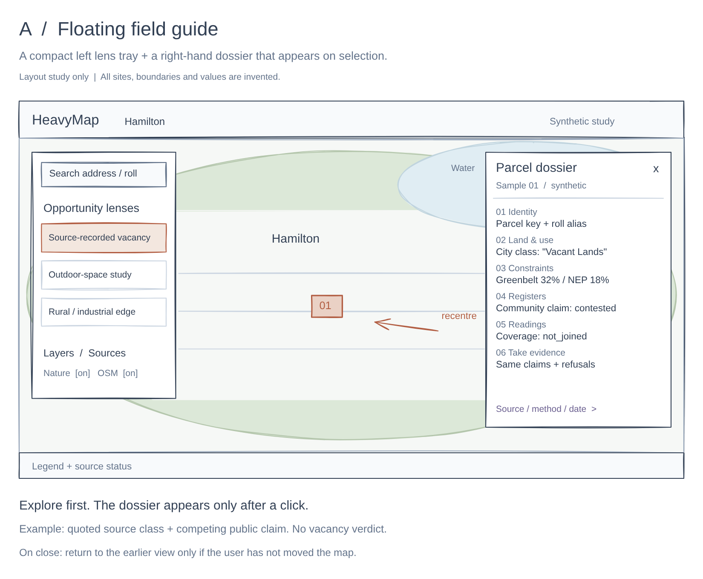
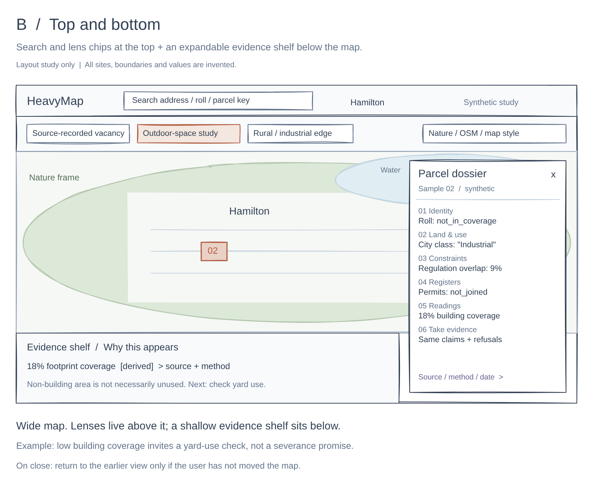
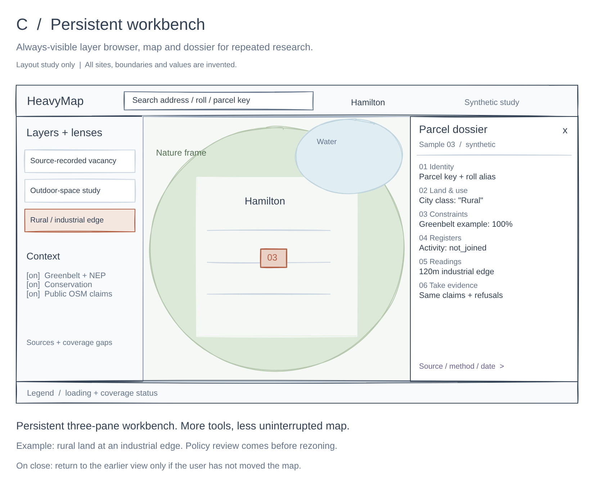

# Simple Excalidraw layout studies

Created 2026-10-17 for Morgen. These are the three **layout scenarios** from [V0-SPEC.md](../V0-SPEC.md), shown with a selected parcel. The three opportunity examples are represented across them to make the evidence surfaces concrete. Any opportunity lens could be used in any layout: the examples do not bind a lens to a layout.

| Layout | Editable Excalidraw | Image preview | Vector preview | Illustrative opportunity example |
| --- | --- | --- | --- | --- |
| A: floating field guide | [Open file](a-floating-field-guide.excalidraw) | [PNG](a-floating-field-guide.png) | [SVG](a-floating-field-guide.svg) | Source-recorded vacancy and a competing community claim |
| B: top and bottom | [Open file](b-top-and-bottom.excalidraw) | [PNG](b-top-and-bottom.png) | [SVG](b-top-and-bottom.svg) | Low building coverage, with actual yard use unknown |
| C: persistent workbench | [Open file](c-persistent-workbench.excalidraw) | [PNG](c-persistent-workbench.png) | [SVG](c-persistent-workbench.svg) | Rural land at an industrial edge, with policy constraints visible |

Open a `.excalidraw` file in Excalidraw using Open/import, or drag it onto the editor. Shapes and text are individually editable. These were generated and exported with Excalidraw 0.18.0 locally. No external board was created, shared or published. Excalidraw's temporary rendering dependencies were not added to the prototype.

These are deliberately simple placement studies, not finished visual designs or complete PCDP dossiers. All shapes, land classes, shares and readings are synthetic. The six-band outline is abbreviated: full source stamps, confidence rationale, every overlapping zone/designation (including slivers, flagged not dropped; see [parcel-dossier.md](../../../docs/architecture/parcel-dossier.md)) and plain-language refusals remain required in the actual dossier. OSM controls illustrate a possible public-input layer, not an active live service. Overpass and selected-element options remain open in the spec.

A: the left tray floats above the map and the right dossier appears on selection. B: lens chips move to the top and an expandable evidence shelf sits below the map. C: both side panes stay present as a workbench, with the right pane showing a prompt when no parcel is selected. All three retain the conditional camera-return behavior in the spec. Mobile is specified there but is not separately mocked up in this set.

